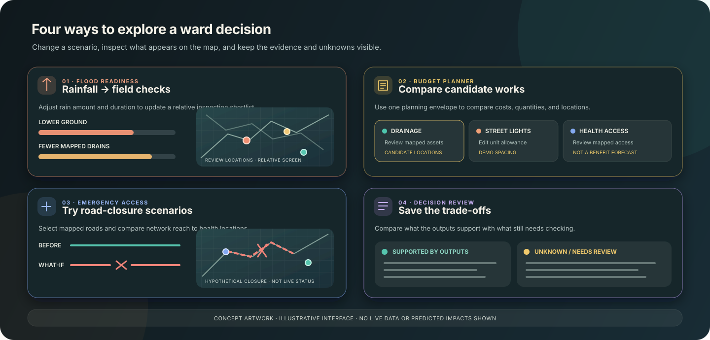
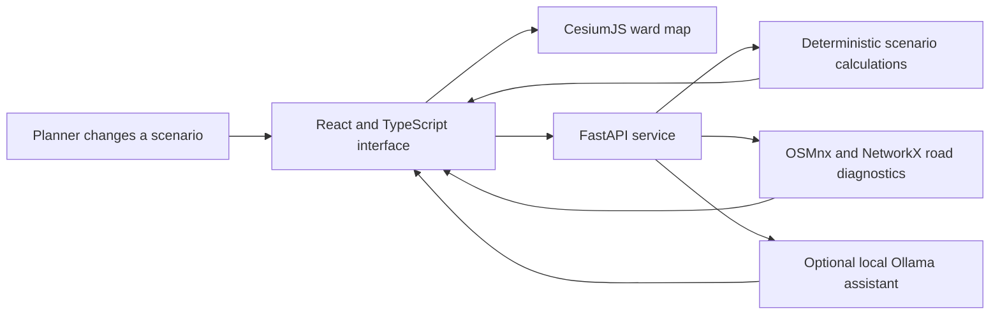

<p align="center">
  
</p>

<h1 align="center">Bharat Yantra</h1>

<p align="center"><strong>An indigenous engineering engine for India</strong><br>
An evidence-aware, map-linked decision laboratory for Mumbai ward planning.</p>

<p align="center">
  <a href="#the-demo">The demo</a> ·
  <a href="docs/JUDGE_GUIDE.md">Judge guide</a> ·
  <a href="docs/SUBMISSION_CHECKLIST.md">Submission checklist</a> ·
  <a href="#how-it-works">How it works</a> ·
  <a href="#run-locally">Run locally</a> ·
  <a href="#data-and-responsible-use">Data and responsible use</a>
</p>

<p align="center"><strong><a href="https://bharat-yantra.vercel.app/">Open the live prototype</a></strong> · <a href="https://github.com/Naveen57990/bharat-yantra">Browse the source on GitHub</a></p>

**For judges:** [Judge guide](docs/JUDGE_GUIDE.md) · [Submission checklist](docs/SUBMISSION_CHECKLIST.md) · [7-slide pitch draft](docs/submission/BharatYantra_HSC2027_Pitch_Draft.pptx) · [Demo-video script](docs/DEMO_VIDEO_SCRIPT.md)

The linked presentation is a content draft, not the official IIT Bombay template version. Add the registered team details and the team's AI-use estimate before uploading it.

> **Prototype notice** — Bharat Yantra is an exploratory demonstration, not an operational government system. Rainfall screening is not a flood forecast. Shelter status, capacity, safety, and evacuation routes are unverified. Use official sources and responsible departments for real-world decisions.

## The idea

Public decisions often involve competing needs, limited budgets, and incomplete local data. Bharat Yantra brings a ward map, scenario controls, and a grounded assistant together so a user can **change an assumption, see the mapped candidates, compare options, and understand what the evidence can—and cannot—support**.

The first testbed is Mumbai’s F/S Ward, selected for local development because several relevant map layers are already available. Its boundary and source rights remain under review; this is not a claim of municipal endorsement or operational readiness.

## Explore the features

<p align="center">
  
</p>

<p align="center"><sub>Feature artwork is illustrative. It contains no live data, geographic boundary, or predicted impact.</sub></p>

| Planning area | What a user can explore | What the result means |
| --- | --- | --- |
| **Ward map** | Provisional ward boundary, mapped roads, buildings, drains, facilities, terrain context, and linked overlays | A local source preview. Data currency, completeness, and reuse rights vary by layer. |
| **Rainfall screening** | Enter rainfall amount and duration; inspect a ranked list of mapped areas | A field-review shortlist based on relative terrain and mapped drains, not predicted flooding or water depth. |
| **Flood stress test** | Change runoff and notional drain-capacity assumptions | Transparent arithmetic for discussion, not a hydraulic simulation or validated forecast. |
| **Emergency access** | Compare network access with a named hypothetical road closure | Road-network diagnostics, not travel time, resident impact, or emergency-response performance. |
| **Budget planner** | Compare candidate works, editable cost assumptions, quantities, and map locations | A planning comparison, not an optimized recommendation or verified estimate of benefits. |
| **Health-facility access** | Explore mapped health features and route options | Community-mapped locations; operating status and capacity are not confirmed. |
| **Action tracker** | Turn a selected plan into map-linked review tasks and update local status | A working checklist, not an official work-order or assignment system. |
| **Map assistant** | Ask about available map evidence or request a named road-closure scenario | Answers are grounded in project guidance and retrieved evidence; missing facts must remain unknown. |

### A short demo walkthrough

1. **Start with a rainfall scenario.** Set an amount and duration. The shortlist and map highlight places ranked for field inspection from relative terrain and mapped-drain evidence.
2. **Compare a public-works budget.** Enter a planning envelope, review drainage, streetlight, and health-access options, then select an option to see its candidate locations on the map.
3. **Test access under disruption.** Select one or more mapped roads as hypothetical closures and compare the share of mapped road points with a route to a mapped health location. The map highlights the selected closures and road points that lose a route in that scenario.
4. **Save and explain the trade-off.** Save the decision comparison, review which points are supported by the calculation and which are still unknown, then ask the assistant for a short explanation grounded in that saved result.

The screens keep assumptions and limitations visible. They do not claim that a proposed work will reduce flooding, protect a number of people, or ensure a safe route.

### Rainfall shortlist rule

For the demo, the number of places shown is calculated as:

```text
ceil(rainfall_mm / 50) + floor(duration_hours / 4)
```

The result is capped by available mapped cells and 20. For the same rainfall amount, a longer duration cannot reduce the shortlist. This is an illustrative screening rule—not measured soil saturation, drainage capacity, or a flood-impact model. The ranked locations are places to inspect, not places the app says will flood. See [Flood methods and limitations](docs/flood_method.md).

## How it works



GIS preparation and source inspection use Python tools. Dataset origins, known quality issues, and publication status are tracked in [`data/provenance/dataset_registry.csv`](data/provenance/dataset_registry.csv). The assistant does not fine-tune on the map; it retrieves available evidence and follows documented response limits.

## Run locally

### Requirements

- Node.js 22.13 or newer and pnpm 11.25.0 (the pinned package manager requires Node 22.13+)
- Python 3.12 (the repository's configured and deployment-tested runtime)
- Optional: Ollama and a locally installed model for the map assistant

### 1. Start the API

From the repository root:

```sh
python3 -m venv .venv
.venv/bin/pip install -r backend/requirements.txt
.venv/bin/uvicorn app.main:app --app-dir backend --host 127.0.0.1 --port 8000 --reload
```

### 2. Start the web app

In a second terminal:

```sh
cd frontend
pnpm install --frozen-lockfile
pnpm dev
```

The Vercel production app serves the static F/S Ward map snapshot and FastAPI from one origin. In the Vercel project settings, set the Root Directory to the repository root (clear `frontend`), then let `vercel.json` install the Python and frontend dependencies and build the Vite app. The app includes the ward data required for its flood screening and road-network endpoints. Run records use Vercel's temporary `/tmp` storage for the demo session; they are not durable across cold starts. Ollama is local-only, so the map assistant's generative responses need a hosted model provider to be configured separately. The bundled map files are public to site visitors; review the provenance registry and source terms before public release. See the [backend guide](backend/README.md) and [frontend deployment notes](frontend/README.md).

### Checks before sharing a change

Run from the repository root:

```sh
./.venv/bin/python -m unittest discover -s backend/tests -v
./.venv/bin/python -m compileall -q backend/app backend/tests
cd frontend && pnpm install --frozen-lockfile && pnpm build
```

Then start the API and check `GET /api/v1/health`, `GET /api/v1/datasets`, `GET /api/v1/accessibility/closure-options`, and `GET /api/v1/flood/evidence`. In the browser, run a facility-access request, test one named hypothetical closure, save a rainfall scenario, and create a preparedness or investment comparison. Confirm that the selected results appear on the map, saved run IDs can be retrieved, and the interface labels results as exploratory rather than forecasts or official advice. See [`backend/tests/test_workflows.py`](backend/tests/test_workflows.py) for the deterministic local-data checks.

## Repository layout

```text
backend/              FastAPI routes and scenario logic
data/provenance/      Dataset source and rights inventory
docs/                 Methods, feasibility, decisions, and assistant evidence rules
docs/assets/          README artwork
frontend/             React, TypeScript, and CesiumJS application
gis/                  GIS preparation and inspection utilities
```

## Data and responsible use

- F/S Ward is a **working development testbed**. Its boundary vintage and authority need verification.
- MCGM, OSM, elevation, building, rainfall, and imagery sources have layer-specific rights, attribution, and quality requirements. Consult the provenance registry before use or redistribution.
- The root [`LICENSE`](LICENSE) applies only to original project software and project-authored documentation. It does not relicense third-party data, maps, images, or other assets. Each dataset retains its own terms and required attribution.
- **Public-release review is still open.** All 19 entries in the provenance registry are currently `hold` because reuse, redistribution, or source-specific obligations remain unresolved. Several held source and derived data files are still tracked in Git and served in the web bundle. This repository therefore is not yet fully cleared for unrestricted redistribution. Do not copy or redistribute held assets based only on this MIT code licence.
- OSM data is under ODbL 1.0 and requires visible attribution plus applicable share-alike terms for distributed altered/derived databases. Copernicus GLO-30 permits use and distribution under its product licence with specific source, modification, liability and no-endorsement notices; see the linked license and required wording in [`data/raw/README.md`](data/raw/README.md). The exact layer-specific release conditions are recorded in the provenance registry; these conditions are separate from the code licence.
- Open Buildings v3 is published by Google under CC BY 4.0 or ODbL 1.0. The subset obtained through Overture remains on hold until the rights and attribution for that accessed subset are documented.
- Sources marked `hold` and products derived from them must not be published until the source-specific review is complete.
- MCGM flood-location and temporary-shelter entries are source records. They do not confirm flood events, current shelter operation, safe access, or capacity.
- Do not use this prototype as an emergency warning, evacuation instruction, official budget recommendation, or operational system.
- Project code is licensed under MIT; third-party data and service terms remain separate. Public release is conditional on resolving or excluding the held data assets and their derivatives.

## Project notes

- [Data feasibility and open gates](docs/feasibility.md)
- [Flood method and limits](docs/flood_method.md)
- [Decision log](docs/DECISIONS.md)
- [Assistant evidence rules](docs/agent_knowledge.md)
- [Emergency-access data quality](docs/accessibility_quality.md)
- [Frontend setup](frontend/README.md)
- [Backend setup and endpoints](backend/README.md)
- [GIS utilities](gis/README.md)
