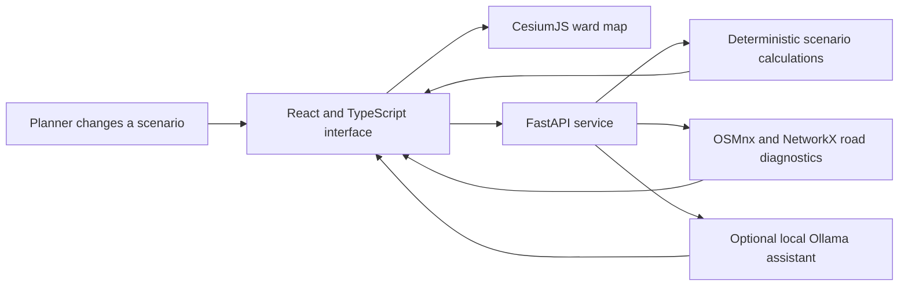

<p align="center">
  
</p>

<h1 align="center">Bharat Yantra</h1>

<p align="center"><strong>An indigenous engineering engine for India</strong><br>
An evidence-aware, map-linked decision laboratory for Mumbai ward planning.</p>

<p align="center">
  <a href="#the-demo">The demo</a> ·
  <a href="#how-it-works">How it works</a> ·
  <a href="#run-locally">Run locally</a> ·
  <a href="#data-and-responsible-use">Data and responsible use</a>
</p>

> **Prototype notice** — Bharat Yantra is an exploratory demonstration, not an operational government system. Rainfall screening is not a flood forecast. Shelter status, capacity, safety, and evacuation routes are unverified. Use official sources and responsible departments for real-world decisions.

## The idea

Public decisions often involve competing needs, limited budgets, and incomplete local data. Bharat Yantra brings a ward map, scenario controls, and a grounded assistant together so a user can **change an assumption, see the mapped candidates, compare options, and understand what the evidence can—and cannot—support**.

The first testbed is Mumbai’s F/S Ward, selected for local development because several relevant map layers are already available. Its boundary and source rights remain under review; this is not a claim of municipal endorsement or operational readiness.

## The demo

| Planning area | What a user can explore | What the result means |
| --- | --- | --- |
| **Ward map** | Provisional ward boundary, mapped roads, buildings, drains, facilities, terrain context, and linked overlays | A local source preview. Data currency, completeness, and reuse rights vary by layer. |
| **Rainfall screening** | Enter rainfall amount and duration; inspect a ranked list of mapped areas | A field-review shortlist based on relative terrain and mapped drains, not predicted flooding or water depth. |
| **Flood stress test** | Change runoff and notional drain-capacity assumptions | Transparent arithmetic for discussion, not a hydraulic simulation or validated forecast. |
| **Emergency access** | Compare network access with a named hypothetical road closure | Road-network diagnostics, not travel time, resident impact, or emergency-response performance. |
| **Budget planner** | Compare candidate works, editable cost assumptions, quantities, and map locations | A planning comparison, not an optimized recommendation or verified estimate of benefits. |
| **Health-facility access** | Explore mapped health features and route options | Community-mapped locations; operating status and capacity are not confirmed. |
| **Action tracker** | Turn a selected plan into map-linked review tasks and update local status | A working checklist, not an official work-order or assignment system. |
| **Map assistant** | Ask about available map evidence or request a named road-closure scenario | Answers are grounded in project guidance and retrieved evidence; missing facts must remain unknown. |

### Rainfall shortlist rule

For the demo, the number of places shown is calculated as:

```text
ceil(rainfall_mm / 50) + floor(duration_hours / 4)
```

The result is capped by available mapped cells and 20. For the same rainfall amount, a longer duration cannot reduce the shortlist. This is an illustrative screening rule—not measured soil saturation, drainage capacity, or a flood-impact model. The ranked locations are places to inspect, not places the app says will flood. See [Flood methods and limitations](docs/flood_method.md).

## How it works



GIS preparation and source inspection use Python tools. Dataset origins, known quality issues, and publication status are tracked in [`data/provenance/dataset_registry.csv`](data/provenance/dataset_registry.csv). The assistant does not fine-tune on the map; it retrieves available evidence and follows documented response limits.

## Run locally

### Requirements

- Node.js and pnpm
- Python 3.11 or newer
- Optional: Ollama and a locally installed model for the map assistant

### 1. Start the API

From the repository root:

```sh
python3 -m venv .venv
.venv/bin/pip install -r backend/requirements.txt
.venv/bin/uvicorn app.main:app --app-dir backend --host 127.0.0.1 --port 8000 --reload
```

### 2. Start the web app

In a second terminal:

```sh
cd frontend
pnpm install --frozen-lockfile
pnpm dev
```

The app is configured for local development. Some map layers are local-only and are intentionally excluded from Git; review the provenance registry and the [frontend setup notes](frontend/README.md) before preparing a deployment. API details are in the [backend guide](backend/README.md).

## Repository layout

```text
backend/              FastAPI routes and scenario logic
data/provenance/      Dataset source and rights inventory
docs/                 Methods, feasibility, decisions, and assistant evidence rules
docs/assets/          README artwork
frontend/             React, TypeScript, and CesiumJS application
gis/                  GIS preparation and inspection utilities
```

## Data and responsible use

- F/S Ward is a **working development testbed**. Its boundary vintage and authority need verification.
- MCGM, OSM, elevation, building, rainfall, and imagery sources have layer-specific rights, attribution, and quality requirements. Consult the provenance registry before use or redistribution.
- Sources marked `hold` and products derived from them must not be published until the source-specific review is complete.
- MCGM flood-location and temporary-shelter entries are source records. They do not confirm flood events, current shelter operation, safe access, or capacity.
- Do not use this prototype as an emergency warning, evacuation instruction, official budget recommendation, or operational system.
- No open-source license is included. Project and dataset reuse rights have not been cleared for general redistribution.

## Project notes

- [Data feasibility and open gates](docs/feasibility.md)
- [Flood method and limits](docs/flood_method.md)
- [Decision log](docs/DECISIONS.md)
- [Assistant evidence rules](docs/agent_knowledge.md)
- [Emergency-access data quality](docs/accessibility_quality.md)
- [Frontend setup](frontend/README.md)
- [Backend setup and endpoints](backend/README.md)
- [GIS utilities](gis/README.md)
